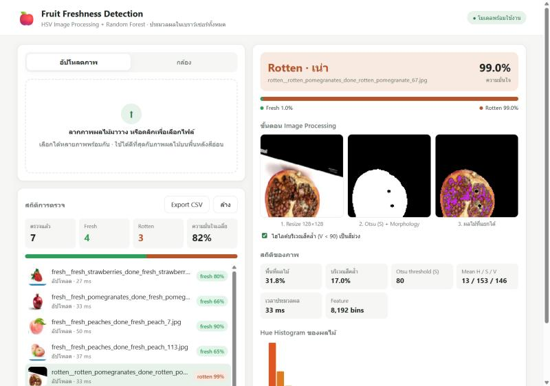
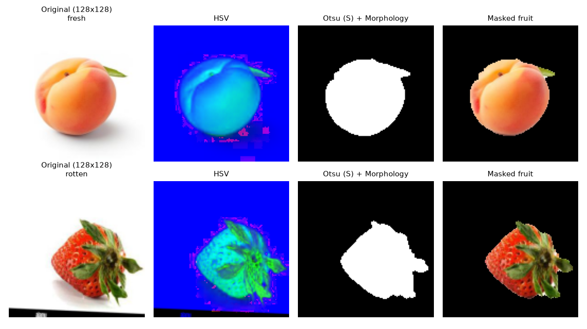
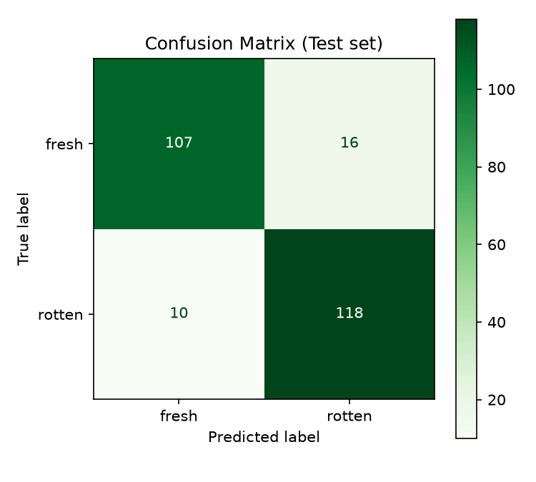

# Fruit Freshness Detection

ระบบ Computer Vision สำหรับตรวจความสดของผลไม้ (Fresh / Rotten) ใช้ Image Processing ร่วมกับ Machine Learning แบบ Classical (ไม่ใช้ YOLO หรือ Deep Learning) และมี Web Application ที่ทำด้วย **Angular** ซึ่งประมวลผลภาพและทำนายผลในเบราว์เซอร์ทั้งหมด ไม่ต้องมี Backend

วิชา Image Processing and Computer Vision | ระยะเวลาโครงงาน 3 สัปดาห์

**ลองใช้งานเว็บ:** <https://computer-vision-project-one.vercel.app> · **วิดีโอสาธิต:** <https://www.youtube.com/watch?v=sG47T_yGzds>



## Problem & Objective

**Problem:** การคัดแยกผลไม้สดกับผลไม้เน่าด้วยสายตาใช้เวลานาน และผลที่ได้ขึ้นกับประสบการณ์ของคนคัด จึงมีความคลาดเคลื่อน

**Objective:**
1. รับภาพผลไม้จากการอัปโหลดหรือจากกล้อง
2. แยกผลไม้ออกจากพื้นหลัง โดยใช้ HSV Color Space, Otsu Thresholding และ Morphology
3. สกัดลักษณะสีด้วย HSV Histogram แล้วจำแนกเป็น Fresh / Rotten ด้วย Random Forest
4. แสดงผลลัพธ์ ค่าความมั่นใจ และสถิติผ่าน Web Application

## Dataset

| รายการ | รายละเอียด |
|---|---|
| ชื่อ Dataset | Fruits Dataset for Classification (Version 1, 2025) |
| แหล่งข้อมูล | Mendeley Data: <https://data.mendeley.com/datasets/rg254yr63x/1> (DOI: [10.17632/rg254yr63x.1](https://doi.org/10.17632/rg254yr63x.1), License: Apache-2.0) |
| ผลไม้ | ลูกพีช (peach), ทับทิม (pomegranate), สตรอว์เบอร์รี (strawberry) |
| จำนวน Class | 2 (Fresh / Rotten) |
| ขนาดภาพ | 300 × 300 px (JPG) |
| จำนวนภาพทั้งหมด | 1,655 ภาพ |

| Split | Fresh | Rotten | รวม | สัดส่วน |
|---|---:|---:|---:|---:|
| Train | 567 | 590 | 1,157 | 70% |
| Validation | 121 | 126 | 247 | 15% |
| Test | 123 | 128 | 251 | 15% |

จำนวนภาพแยกตามชนิดผลไม้: fresh peaches 250, fresh pomegranates 311, fresh strawberries 250, rotten peaches 343, rotten pomegranates 250, rotten strawberries 251

> หน้า dataset ระบุว่ามีชนิดละประมาณ 250 ภาพ (รวม 1,500 ภาพ) แต่ไฟล์ที่ดาวน์โหลดมาใช้จริงมี 1,655 ภาพตามตารางด้านบน

**การเตรียมข้อมูล:** ไฟล์ที่ดาวน์โหลดมาเป็น zip ซ้อน 2 ชั้น แตกแล้วได้ 6 โฟลเดอร์ตามชนิดผลไม้ จากนั้นใช้ `src/split_dataset.py` รวมโฟลเดอร์ fresh_* เป็นคลาส Fresh และ rotten_* เป็นคลาส Rotten แล้วสุ่มแบ่ง 70/15/15 ทีละโฟลเดอร์ (ให้ผลไม้ทุกชนิดกระจายอยู่ในทุก split) ด้วย `random seed = 42` ตรวจแล้วไม่มีภาพเสีย และทุกภาพขนาด 300×300 เท่ากัน

โครงสร้างโฟลเดอร์ (ไม่ได้อัปโหลด dataset ขึ้น GitHub):

```
dataset/
├── train/{fresh,rotten}/*.jpg
├── val/{fresh,rotten}/*.jpg
└── test/{fresh,rotten}/*.jpg
```

## Methodology

```
Dataset → Resize 128×128 → HSV Color Space → Otsu Threshold (S channel) → Morphology (Close + Open)
        → HSV Histogram 32×32×8 (เฉพาะพิกเซลผลไม้) → L2 Normalize → StandardScaler → Random Forest
        → Evaluation → Export ONNX → Angular Web Application (Client-side Inference)
```

### Image Processing

ตัวอย่างการทำงานแต่ละขั้น (ได้จาก `src/evaluate.py`):



| ขั้นตอน | เทคนิค | เหตุผล |
|---|---|---|
| 1 | **Resize** 128×128 (`INTER_AREA`) | ให้ภาพทุกภาพมีขนาดเท่ากัน และลดเวลาประมวลผล |
| 2 | **HSV Color Space** | แยกข้อมูลสี (H) ความอิ่มตัวของสี (S) และความสว่าง (V) ออกจากกัน ผลไม้เน่ามักมีสีคล้ำ (V ต่ำ) และสีเปลี่ยนไปทางน้ำตาล |
| 3 | **Otsu Thresholding** บนช่อง S | พื้นหลังสีขาวหรือเทามีค่า S ต่ำ ส่วนผลไม้มีค่า S สูง Otsu จึงหา threshold ให้แต่ละภาพได้เองโดยไม่ต้องตั้งค่าตายตัว |
| 4 | **Morphology** Close + Open (ellipse 5×5) | Close ปิดรูเล็ก ๆ ในตัวผลไม้ และ Open ลบจุดรบกวนบนพื้นหลัง |

### Feature Extraction

- **3D HSV Histogram** ขนาด H 32 bins × S 32 bins × V 8 bins = **8,192 features** คำนวณเฉพาะพิกเซลที่อยู่ใน mask (ส่วนที่เป็นผลไม้)
- **L2 Normalization** ทำให้ feature ไม่ขึ้นกับขนาดของผลไม้ในภาพ

## Algorithm / Model

| รายการ | ค่า |
|---|---|
| Model | `RandomForestClassifier` (scikit-learn 1.7.2) |
| Hyperparameters | `n_estimators=200`, `max_depth=15`, `max_features='sqrt'`, `random_state=42` |
| Scaling | `StandardScaler` |
| ไฟล์โมเดล | `models/model.pkl` (Python), `frontend/public/model.onnx` (เบราว์เซอร์) |

### เปรียบเทียบโมเดล

ใช้ feature ชุดเดียวกัน เทียบ SVM กับ Random Forest และลอง Random Forest แบบไม่ใช้ mask (คิด histogram ทั้งภาพรวมพื้นหลัง) เพื่อดูผลของการตัดพื้นหลัง (รันซ้ำได้ด้วย `src/compare_models.py`)

| โมเดล | ใช้ mask | Val Accuracy | Test Accuracy | Test F1 (Rotten) |
|---|:---:|---:|---:|---:|
| SVM (RBF, C = 1) | ใช้ | 0.8866 | 0.8367 | 0.8487 |
| SVM (RBF, C = 10) | ใช้ | 0.8907 | 0.8645 | 0.8768 |
| Random Forest | ไม่ใช้ | 0.9150 | 0.9004 | 0.9057 |
| **Random Forest** | **ใช้** | **0.9231** | 0.8964 | 0.9008 |

- Random Forest ดีกว่า SVM ชัดเจน จึงเลือกเป็นโมเดลหลัก
- แบบใช้ mask ดีกว่าบน Validation set แต่บน Test set แบบไม่ใช้ mask สูงกว่าเล็กน้อย (ต่างกัน 1 ภาพ) แปลว่าใน dataset นี้ mask ช่วยไม่มากเพราะภาพส่วนใหญ่พื้นหลังขาวอยู่แล้ว แต่ยังเลือกใช้ mask เพราะทำให้ histogram มาจากสีของผลไม้จริง ซึ่งสำคัญกับภาพถ่ายจริงที่พื้นหลังไม่ใช่สีขาว

## Evaluation

ผลบน **Test set** (251 ภาพ ซึ่งโมเดลไม่เคยเห็นตอน train):

| Metric | Test | Validation |
|---|---:|---:|
| Accuracy | **0.8964** | 0.9231 |
| Precision (macro) | 0.8976 | 0.9231 |
| Recall (macro) | 0.8959 | 0.9230 |
| F1-score (macro) | 0.8962 | 0.9230 |

| Class (Test) | Precision | Recall | F1-score | Support |
|---|---:|---:|---:|---:|
| Fresh | 0.9145 | 0.8699 | 0.8917 | 123 |
| Rotten | 0.8806 | 0.9219 | 0.9008 | 128 |



- Fresh ถูกทายผิดเป็น Rotten 16 ภาพ และ Rotten ถูกทายผิดเป็น Fresh 10 ภาพ
- Recall ของ Rotten สูงกว่า (0.92) แปลว่าระบบมีแนวโน้มจับผลไม้เน่าได้ครบ ซึ่งเป็นสิ่งสำคัญในงานคัดแยก
- ภาพที่ทายผิดส่วนใหญ่เป็นภาพที่พื้นหลังไม่ใช่สีขาว หรือมีวัตถุอื่นปนอยู่ในภาพ ทำให้ Otsu แยกผลไม้ได้ไม่สมบูรณ์

**ความถูกต้องของ Web Application:** ผ่านการตรวจแล้วว่า feature ที่คำนวณด้วย TypeScript ในเบราว์เซอร์**เท่ากับ Python ทุกค่า** (bit-exact บน 498 ภาพของ val + test) และผลทำนายของ ONNX ตรงกับ scikit-learn 100%

## Application

Web Application ทำด้วย **Angular** แบบ **Client-side Inference** ไม่มี Backend API ภาพของผู้ใช้จึงไม่ถูกส่งออกจากเครื่อง ใช้งานได้ที่ <https://computer-vision-project-one.vercel.app> (deploy บน Vercel)

- **Upload ภาพ**: ลากมาวางหรือคลิกเลือก ได้หลายภาพพร้อมกัน
- **กล้อง**: ถ่ายแล้ววิเคราะห์ หรือเปิดโหมด Live ที่วิเคราะห์ทุก 0.5 วินาที
- **แสดงขั้นตอน Image Processing**: ภาพหลัง resize, mask จาก Otsu + Morphology และผลไม้ที่แยกได้ พร้อมไฮไลต์บริเวณสีคล้ำ
- **ผลลัพธ์**: Fresh / Rotten พร้อมค่าความมั่นใจและความน่าจะเป็นของทั้ง 2 คลาส
- **สถิติของภาพ**: พื้นที่ผลไม้ (%), บริเวณสีคล้ำ (%), Otsu threshold, ค่าเฉลี่ย H/S/V, เวลาประมวลผล และ Hue Histogram
- **สถิติการตรวจ**: จำนวนที่ตรวจทั้งหมด, Fresh/Rotten, ความมั่นใจเฉลี่ย, ประวัติการตรวจ และ Export CSV

| ไฟล์ | หน้าที่ |
|---|---|
| `frontend/src/app/hsv-processing.ts` | Resize (INTER_AREA), HSV, Otsu, Morphology, HSV Histogram เขียนตามอัลกอริทึมของ OpenCV |
| `frontend/src/app/model-inference.ts` | โหลด `model.onnx` ด้วย `onnxruntime-web` แล้วทำนายผล |
| `frontend/src/app/fruit-analysis.ts` | สถิติและภาพที่ใช้แสดงผล |
| `frontend/src/app/app.ts`, `app.html` | หน้า UI |

## Project Structure

```
fruit-freshness-detection/
├── frontend/                          # Angular (client-side inference)
│   ├── public/model.onnx              # โมเดลที่แปลงจาก sklearn → ONNX
│   ├── scripts/verify-features.mts    # ตรวจว่า feature จาก TypeScript = Python
│   └── src/app/
│       ├── hsv-processing.ts
│       ├── model-inference.ts
│       ├── fruit-analysis.ts
│       └── app.ts / app.html
├── src/                               # Python: ฝั่ง training / evaluation
│   ├── preprocessing.py               # Resize, HSV, Otsu Thresholding, Morphology
│   ├── feature_extraction.py          # HSV Histogram
│   ├── dataset.py                     # โหลด dataset
│   ├── classification.py              # Train Random Forest
│   ├── evaluate.py                    # Accuracy / Precision / Recall / F1 / Confusion Matrix
│   ├── compare_models.py              # เทียบ SVM / Random Forest แบบใช้และไม่ใช้ mask
│   ├── split_dataset.py               # รวมเป็น 2 คลาส + แบ่ง Train/Val/Test (70/15/15, seed 42)
│   ├── export_onnx.py                 # sklearn → ONNX
│   └── export_reference.py            # ข้อมูลอ้างอิงสำหรับ verify-features
├── models/model.pkl
├── images/                            # preprocessing_steps.png, result.jpg
├── results/                           # confusion_matrix.png, classification_report.png, metrics.json
├── requirements.txt
└── README.md
```

## How to Run

### 1. Python: Evaluation / Train / Export ONNX

ต้องใช้ Python 3.10 ขึ้นไป และวาง dataset ไว้ที่ `dataset/`

```bash
git clone https://github.com/CcGthilha/Computer-Vision-Project-.git
cd Computer-Vision-Project-
python -m venv .venv
.venv\Scripts\activate          # macOS/Linux: source .venv/bin/activate
pip install -r requirements.txt

python src/evaluate.py          # ประเมินผล models/model.pkl → results/
python src/export_onnx.py       # แปลงเป็น frontend/public/model.onnx
python src/classification.py    # (ไม่บังคับ) train ใหม่ → models/model_new.pkl
python src/compare_models.py    # (ไม่บังคับ) เทียบ SVM / Random Forest แบบใช้และไม่ใช้ mask
```

ถ้าเริ่มจากไฟล์ที่ดาวน์โหลดจาก Mendeley: แตก zip ทั้ง 2 ชั้นไว้ในโฟลเดอร์ `Fruits Dataset for Classification/` แล้วรัน `python src/split_dataset.py` จะได้โฟลเดอร์ `dataset/` ที่แบ่งแล้ว

### 2. Angular Web Application

ต้องใช้ Node.js 20 ขึ้นไป

```bash
cd frontend
npm install
npm start
```

เปิดเบราว์เซอร์ที่ `http://localhost:4200` แล้วอัปโหลดภาพผลไม้หรือเปิดกล้อง

### 3. (ไม่บังคับ) ตรวจว่า feature ฝั่ง TypeScript เท่ากับ Python

```bash
python src/export_reference.py
cd frontend
node scripts/verify-features.mts ../reference
```

## Technology Stack

| เครื่องมือ | หน้าที่ |
|---|---|
| Python | พัฒนาและ Train Model |
| OpenCV | Image Processing (Resize, HSV, Otsu, Morphology, calcHist) |
| scikit-learn | StandardScaler, Random Forest, Evaluation |
| skl2onnx / onnxruntime | แปลงโมเดลเป็น ONNX และตรวจผล |
| NumPy / Matplotlib | จัดการข้อมูล และสร้างกราฟผลการประเมิน |
| Angular | Web Application (Frontend) |
| onnxruntime-web | รันโมเดล ONNX ในเบราว์เซอร์ (WebAssembly) |
| TypeScript / Canvas API | ประมวลผลภาพและสกัด HSV Histogram ฝั่ง Client |
| Git / GitHub | จัดเก็บ Source Code |

## Results

- ระบบจำแนกผลไม้สด/เน่าบน Test set ได้ **Accuracy 89.6%** และ F1-score 0.896 โดยใช้เพียง feature สีจาก HSV Histogram ร่วมกับ Random Forest ดีกว่า SVM (86.5%)
- Image Processing (HSV + Otsu + Morphology) แยกผลไม้ออกจากพื้นหลังสีอ่อนได้ดี ทำให้ histogram สะท้อนสีของผลไม้จริง ไม่ปนกับสีพื้นหลัง
- Web Application ทำงานในเบราว์เซอร์ทั้งหมด ประมวลผลภาพละประมาณ 30–70 ms และให้ผลตรงกับ Python ทุกภาพ

**ข้อจำกัด:**
- ใช้เฉพาะ feature สี จึงไม่จับลักษณะพื้นผิว เช่น รอยย่นหรือรา ที่สีไม่ต่างจากผลไม้สด
- ใช้ได้ดีกับภาพพื้นหลังสีอ่อนแบบใน dataset ถ้าพื้นหลังมีสีสด Otsu จะแยกผลไม้ได้ไม่ดี
- train กับผลไม้ 3 ชนิด ถ้าใช้กับผลไม้ชนิดอื่นความแม่นยำอาจลดลง

**แนวทางพัฒนาต่อ:** เพิ่ม texture feature (เช่น LBP หรือ GLCM), รองรับผลไม้หลายผลในภาพเดียวด้วย contour detection และเพิ่มจำนวนชนิดผลไม้

## Demo

วิดีโอสาธิตการใช้งาน: <https://www.youtube.com/watch?v=sG47T_yGzds>

## Team

| รหัสนิสิต | ชื่อ - นามสกุล |
|---|---|
| 67011212113 | ช่อทิพย์ ลือจันดา |
| 67011212073 | อภิรักษ์ ยะมะหาร |
| 66011212101 | ธีรพงศ์ เพ็งแข |
| 66011212242 | ปารเมศ ศรีจันทร์ชัย |

### Task Division

| ผู้รับผิดชอบ | ส่วนงาน | งานที่ทำ | Deliverable |
|---|---|---|---|
| อภิรักษ์ ยะมะหาร | Dataset & Data Preparation | หา/ดาวน์โหลด dataset, ทำความสะอาดข้อมูล, แบ่ง Train/Val/Test, สรุปข้อมูลลง README | `src/split_dataset.py`, Dataset พร้อมใช้ + เอกสารสรุป |
| ปารเมศ ศรีจันทร์ชัย | Image Processing & Feature Extraction | HSV conversion, Otsu Thresholding, Morphology, สกัด HSV Histogram | `src/preprocessing.py`, `src/feature_extraction.py` |
| ธีรพงศ์ เพ็งแข | Model Training & Evaluation | Train Random Forest, เทียบกับ SVM, ประเมินผล (accuracy, precision, recall, F1, confusion matrix) | `src/classification.py`, `src/evaluate.py`, `src/compare_models.py`, `models/model.pkl`, `results/` |
| ช่อทิพย์ ลือจันดา | Angular Web App (Client-side Inference) | แปลงโมเดลเป็น ONNX, เขียน Angular app, จัดการ GitHub/README, อัดวิดีโอ demo | `frontend/`, `model.onnx`, วิดีโอ demo |
